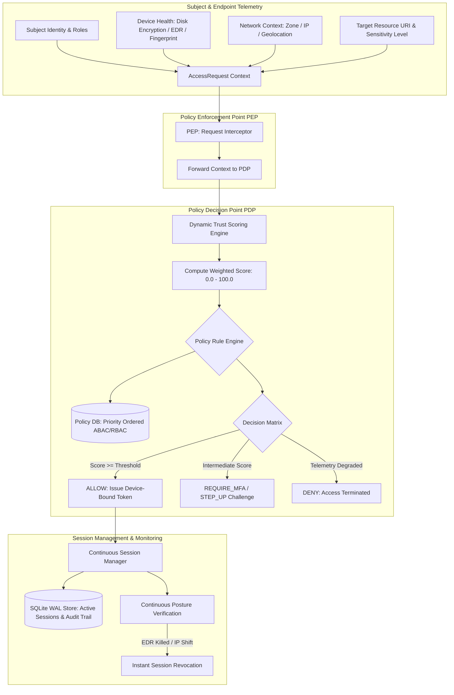

# Zero-Trust Access Control Platform (`ztac`)

Enterprise Zero-Trust Architecture (ZTA) Engine Implementing NIST SP 800-207, Decoupled PDP/PEP Policy Enforcement, Dynamic Multi-Factor Trust Scoring, Device-Bound HMAC Tokens, and Continuous Session Verification.

[](https://github.com/Krish9800/zero-trust-access-control-platform/actions)
[](https://opensource.org/licenses/MIT)
[](https://www.python.org/)
[](https://csrc.nist.gov/publications/detail/sp/800/207/final)
[](https://csrc.nist.gov/projects/attribute-based-access-control)

---

## Overview & Problem Statement

Traditional perimeter-based network security ("castle-and-moat") assumes that any identity or device inside the corporate intranet can be trusted implicitly. Once an adversary breaches the perimeter via compromised credentials, phishing, or vulnerable edge VPNs, they can move laterally unrestricted across internal subnets and sensitive services.

**Zero-Trust Access Control Platform (`ztac`)** eliminates implicit perimeter trust by adhering to the core tenets of **NIST SP 800-207**: *Never Trust, Always Verify*. Every access request undergoes strict contextual verification. The system evaluates subject identity, hardware authentication assurance, real-time endpoint health (disk encryption, active EDR), network threat zone, and resource sensitivity to compute a dynamic composite trust score (0.0 to 100.0) before issuing cryptographically bound ephemeral tokens.

---

## Architecture & Data Flow



---

## Verified Features & Capabilities

- **NIST SP 800-207 Compliant Architecture**: Strictly separates the Policy Enforcement Point (PEP) from the Policy Decision Point (PDP) and Policy Administration Point (PAP).
- **Dynamic Multi-Factor Trust Scoring**: Calculates real-time composite trust scores (0.0 to 100.0) based on weighted contextual attributes:
  - Subject authentication strength (FIDO2 hardware key, MFA, single password).
  - Endpoint security posture (OS version, BitLocker/LUKS disk encryption, EDR heartbeat).
  - Network trust zones (`CORPORATE_MANAGED`, `VPN_AUTHENTICATED`, `PUBLIC_INTERNET`, `ANONYMOUS_TOR`).
  - Target resource sensitivity (`LOW`, `MEDIUM`, `HIGH`, `CRITICAL`).
- **Cryptographic Device-Bound Tokens**: Generates HMAC-SHA256 session tokens bound to endpoint hardware fingerprint hashes, preventing token hijacking, replay, and Pass-the-Cookie attacks.
- **Continuous Posture Monitoring & Instant Revocation**: Tracks active sessions and terminates access immediately if endpoint telemetry changes (e.g. anti-malware service stopped or anomalous network route detected).
- **Hybrid ABAC + RBAC Policy Engine**: Evaluates rule priorities with default-deny semantics, condition matching, and fine-grained role attributes.
- **ACID SQLite WAL Storage**: High-speed local persistence with write-ahead logging (WAL) for session tables, policy catalogues, and audit logs.
- **FastAPI Control Plane & Typer CLI**: Full programmatic and operational control via interactive terminal tooling and async REST endpoints.

---

## Technology Stack

- **Framework**: Python 3.12+, Typer, Rich, Pydantic v2
- **REST Control Plane**: FastAPI, Uvicorn, Starlette
- **Data Persistence**: SQLite (Write-Ahead Logging mode)
- **Cryptography**: Standard library `hmac`, `hashlib`, `secrets` (timing-attack safe comparison)
- **Quality & Assurance**: Pytest, Pytest-Asyncio, Ruff, Mypy (strict typing)
- **Containerization**: Rootless multi-stage Docker (`UID 10001`)

---

## CLI Reference & Operational Usage

The platform provides the `ztac` administration CLI:

```bash
# 1. Evaluate an access request through the Policy Decision Point (PDP)
ztac eval   --subject "alice@corp.example"   --roles "engineering,devops"   --resource "/api/v1/prod/infrastructure"   --sensitivity "CRITICAL"   --encrypted   --edr   --zone "CORPORATE_MANAGED"

# 2. Simulate evaluation from an untrusted public network
ztac eval   --subject "contractor@external.org"   --roles "contractor"   --resource "/api/v1/internal/docs"   --sensitivity "HIGH"   --unencrypted   --no-edr   --zone "PUBLIC_INTERNET"

# 3. List all active Zero-Trust sessions
ztac sessions

# 4. List all historical and revoked sessions
ztac sessions --all

# 5. Instantly revoke an active session with reason
ztac revoke "<session-uuid>" --reason "Security telemetry alert: EDR agent unresponsive"

# 6. List configured access policies ordered by evaluation priority
ztac policies
```

---

## REST API Control Plane

Start the FastAPI daemon:

```bash
uvicorn zero_trust.api.app:app --host 127.0.0.1 --port 8000
```

Access the interactive OpenAPI UI at `http://127.0.0.1:8000/docs`.

### Primary Endpoints

| Method | Endpoint | Description |
|:-------|:---------|:------------|
| `GET` | `/health` | Health telemetry and control plane status |
| `POST` | `/api/v1/access/evaluate` | Submit access request context for PDP evaluation and token issuance |
| `GET` | `/api/v1/sessions` | Retrieve list of active sessions (supports active filtering) |
| `POST` | `/api/v1/sessions/{session_id}/revoke` | Revoke active access session with reason code |
| `GET` | `/api/v1/policies` | Retrieve all registered Zero-Trust policies |
| `POST` | `/api/v1/policies` | Create or update a contextual access policy |
| `DELETE` | `/api/v1/policies/{policy_id}` | Delete a policy by ID |

---

## Installation & Setup

```bash
# Clone the repository
git clone https://github.com/Krish9800/zero-trust-access-control-platform.git
cd zero-trust-access-control-platform

# Create virtual environment
python3 -m venv .venv
source .venv/bin/activate

# Install dependencies in editable mode
pip install --upgrade pip
pip install -e ".[dev]"
```

---

## Testing & Quality Assurance

Run the comprehensive unit, integration, and security test suite:

```bash
# Run pytest test suite
pytest

# Run tests with code coverage metrics
pytest --cov=zero_trust --cov-report=term-missing

# Linting and formatting checks
ruff check .
ruff format --check .

# Static type verification
mypy src/zero_trust
```

---

## Security Model & Threat Boundaries

Documented under `docs/threat_model.md`:

- **Token Exfiltration Defense**: Session tokens are cryptographically bound to hardware fingerprints. Even if an attacker steals an active session token, request validation fails without the matching device fingerprint.
- **Timing-Attack Resistance**: Token validation utilizes constant-time string comparisons (`hmac.compare_digest`) to defeat side-channel timing attacks.
- **Fail-Closed Default**: In the absence of an explicitly matching permissive policy or if endpoint telemetry fails sanity checks, the decision defaults to strict `DENY`.

---

## Limitations & Known Issues

- **Local Device Telemetry Simulation**: In standalone CLI mode, endpoint health attributes are supplied via structured telemetry payloads. In production deployments, integration with an endpoint management MDM or EDR agent (e.g. CrowdStrike, Microsoft Defender, Osquery) is required.
- **SQLite Single-Node Scope**: Embedded SQLite WAL is optimized for single-host control planes; clustered setups utilize distributed consensus stores.

---

## License & Responsible Use

Distributed under the **MIT License** - see [LICENSE](https://opensource.org/licenses/MIT).

> [!NOTE]
> Designed for enterprise zero-trust research, continuous access control simulation, and policy evaluation testing.
